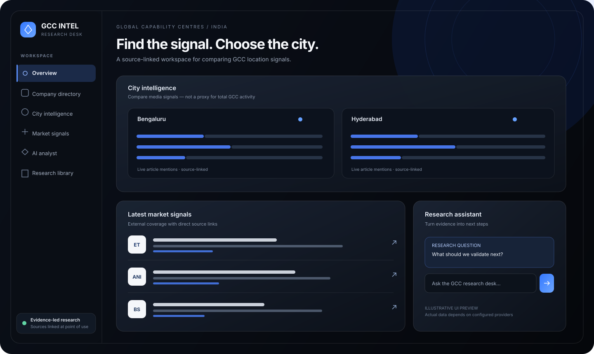

<div align="center">

# GCC Intel

### Find the signal. Choose the city.

**An evidence-led research workspace for comparing India's Global Capability Centre ecosystem.**

[](https://pd-role.vercel.app)
[](https://github.com/coder911i/pd-role/actions)
[](#project-status)

[Live app](https://pd-role.vercel.app) · [Architecture](docs/ARCHITECTURE.md) · [Production checklist](docs/PRODUCTION_CHECKLIST.md) · [Pitch deck brief](docs/PITCH_DECK_PROMPT.md)

</div>

---

## Product preview

<p align="center">
  
</p>

> **Preview note:** This is an illustrative interface mockup, not a captured screenshot of the live application. Live news and AI responses depend on external providers and configured environment variables.

## Why this exists

GCC location research is scattered across company pages, news coverage, policy documents, market reports, and analyst notes. **GCC Intel brings several of those signals into one place** so a researcher can explore a reference company directory, scan linked news, compare city-level media mentions, and save research for follow-up.

The product is a research aid—not an authoritative census or an automated location recommendation engine.

## What you can do

| Area | Capability | Important limitation |
|---|---|---|
| **Company directory** | Search a reference list and filter by city or sector; follow company/source links. | The list is not a continuously verified census of GCC offices. |
| **Market signals** | Fetch GCC-related news from GDELT and open the source article. | Coverage depends on provider availability, query matching, and rate limits. |
| **City intelligence** | Compare city-level article-mention signals from the retrieved feed. | Article mentions are not a proxy for talent, GCC counts, hiring, or operating cost. |
| **Research analyst** | Ask questions through the server-side Groq API integration. | Availability and answer quality depend on configuration and retrieved evidence. |
| **Research library** | Save companies and research reports for later. | Persistent storage requires a configured Neon database; sessions are anonymous, not user accounts. |
| **Responsive UI** | Use the workspace on desktop and mobile. | Validate key flows in target browsers before production launch. |

## Run locally

**One-line clone + install + run:**

```bash
git clone https://github.com/coder911i/pd-role.git && cd pd-role && npm install && npm run dev
```

Open the local URL printed by Vite.

**Requirements:** Node.js 20+ and npm.

For a production build and tests:

```bash
npm run build && npm test
```

To preview the built frontend locally:

```bash
npm run build && npm run preview
```

> The plain Vite dev server serves the frontend only. To run Vercel-style `/api/*` routes locally, use `npx vercel dev` and configure local environment variables.

## Production deployment

Deploy on Vercel by importing this repository, using the **Vite** framework preset, build command `npm run build`, and output directory `dist`. Configure server-side environment variables before testing API-dependent features.

| Variable | Required for | Notes |
|---|---|---|
| `GROQ_API_KEY` | AI analyst | Secret; server-side only. Never expose it as a `VITE_*` variable. |
| `GROQ_MODEL` | Optional model override | Defaults to `openai/gpt-oss-120b` in the current API implementation. |
| `DATABASE_URL_POOLED` | Saved companies/reports | Recommended pooled Neon PostgreSQL URL for serverless runtime. |
| `DATABASE_URL` | Database fallback | Optional direct connection string. |
| `SESSION_SECRET` | Signed anonymous sessions | Use a long, random production secret. |

After changing environment variables, redeploy and verify the production deployment. Never commit real credentials to Git.

See [Production checklist](docs/PRODUCTION_CHECKLIST.md) for launch checks and [Architecture](docs/ARCHITECTURE.md) for system boundaries.

## Architecture

```text
React + Vite UI
  ├── Company directory ─────── /api/directory
  ├── News signals ──────────── /api/signals ── GDELT DOC 2.0
  ├── AI research analyst ───── /api/chat ───── Groq API
  └── Saved research ────────── /api/saved, /api/reports
                                      │
                                Neon PostgreSQL
```

- **Frontend:** React 18, Vite 6, Three.js, Lucide React.
- **API:** Vercel serverless functions.
- **AI:** Groq Chat Completions API.
- **Persistence:** optional Neon PostgreSQL via `@neondatabase/serverless`.
- **Quality:** Node's built-in test runner and GitHub Actions.

Repository layout:

```text
api/                 Serverless API routes and shared utilities
src/                 React application, styles, and frontend helpers
src/lib/             Reusable helpers with deterministic behavior
tests/               Unit and API contract tests
docs/                Architecture, production checklist, deck brief
assets/              README product-preview artwork
.github/workflows/   CI build and test workflow
```

## Quality checks

Run before submitting a change:

```bash
npm install
npm run build
npm test
```

CI runs the production build and test suite on pushes to `main`, pull requests, and manual dispatches. A green unit-test run does not replace browser-based checks of the deployed application.

## Data integrity and known limitations

- The directory is a reference dataset; city and sector labels may need fresh official-source verification.
- News is sourced through GDELT. External source coverage, article metadata, and rate limits can change.
- City mention counts represent keyword matches in the current article feed, not a verified measure of GCC activity.
- Salary, talent supply, office rent, hiring totals, and incentive savings are not inferred from news counts.
- Saved data uses a signed anonymous session, not account authentication.
- The in-memory rate guard is best-effort per serverless instance, not a shared distributed rate limiter.
- Production readiness requires configuration, security review, durable rate limiting, monitoring, backups, and end-to-end verification appropriate to the deployment.

See [Production checklist](docs/PRODUCTION_CHECKLIST.md).

## Product context

This repository supports a product-analysis exercise comparing Bengaluru and Hyderabad for an AI-focused GCC. It is an independent project and is **not affiliated with or endorsed by Swiggy**. Any assignment submission should clearly distinguish sourced facts, assumptions, estimates, and recommendations.

## Project status

This project is actively evolving. Review the [CI runs](https://github.com/coder911i/pd-role/actions) and verify the live deployment before relying on a feature. No claim of full production readiness is made solely from a successful build.

<div align="center">

**Built to make location research clearer, faster, and easier to verify.**

</div>
